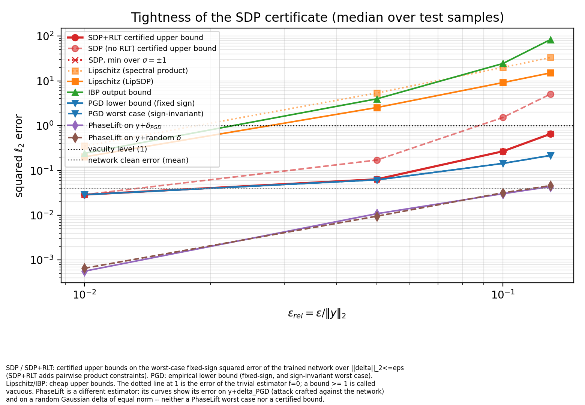

# Certified Robustness of DNN Phase Retrieval via SDP (+ RLT)

Semidefinite-programming (SDP) certificates for a small ReLU network that solves real-valued phase retrieval on 8×8 MNIST.
Given measurements `y = (Ax)^2` perturbed by any `delta` with `||delta||_2 <= eps`, we compute a **certified upper bound** on the
worst-case squared reconstruction error of the network, and measure how tight it is against PGD attacks (lower bounds),
cheap baselines (IBP, Lipschitz, LipSDP) and PhaseLift.

ECE285 course project (UCSD) by Chengen Ruan and Xinqi Li.

## Main findings

* **RLT makes the certificate usable.** Adding pairwise product constraints (Reformulation-Linearization Technique) to the plain SDP
  tightens the median certified bound by up to **87.1 %** (at `eps_rel = 0.13`: 5.087 → 0.656; per-sample reductions reach 91 %).
* **Non-vacuous radius.** "Vacuous" means the bound is `>= 1`, the error of the trivial estimator `f = 0` (because `||x|| = 1`).
  IBP and Lipschitz bounds are vacuous on 100 % of samples from `eps_rel = 0.05`, plain SDP from `eps_rel = 0.10`.
  SDP+RLT stays non-vacuous at `eps_rel = 0.13` on **19 of 20** samples. The one exception (test sample 1) has a PGD *lower* bound
  of 1.05 > 1, so no valid certificate could be below 1 there; SDP+RLT gives 1.076.
* **Tightness.** Median SDP+RLT / PGD ratio: 1.00 (`eps_rel` 0.01, 0.05), 1.64 (0.10), 2.60 (0.13).
  With no unstable ReLUs the relaxation is exact (S-lemma), and the certificate matches PGD to within 1e-9.
* **Speed trade-off.** Network inference takes 0.05 ms per sample versus about 3 s for one PhaseLift solve. Certifying the network is
  cheap for small perturbations but its cost grows quickly with the number of unstable neurons (see Timing).

## Setup

| Item | Value |
| --- | --- |
| Signal | 8×8 MNIST, `n = 64`, normalised to `||x||_2 = 1` |
| Measurements | `m = 256 = 4n`, Gaussian `A` drawn once (seed 0) and shared by training, testing and PhaseLift; `y_k = <a_k, x>^2` |
| Network | MLP `256 -> 128 (ReLU) -> 64`, i.e. one hidden layer; sign-invariant loss `min_{s=±1} ||f(y) - s x||^2`; 60 epochs, 20,000 training samples |
| Clean test error | mean **0.0398**, median 0.0313 (sign-invariant squared error, all 500 test samples) |
| Perturbation set | full `l2` ball `||delta||_2 <= eps` (so `y + delta` may be negative); PGD uses exactly the same set |
| Grid | absolute `eps`, reported as `eps_rel = eps / mean||y||_2` with `mean||y||_2 = 29.84`: `{0.01, 0.05, 0.10, 0.13}` = `eps` of `{0.30, 1.49, 2.98, 3.88}` |
| Samples | first 20 test samples for the full evaluation (Phase 4); 5–10 for the earlier phases |
| Attack | PGD with 300 steps and 20 random restarts (Phases 2–4), on the same `l2` ball; a fixed-sign attack and a separate sign-invariant attack |
| Error metric | squared `l2` error throughout |

## Method

For the bound we fix the sign `sigma0` that is best at `delta = 0` and bound `max_{||delta|| <= eps} ||f(y + delta) - sigma0 x||^2`.
Because `max_delta min_sigma <= min_sigma max_delta`, this also bounds the sign-invariant error.
(Phase 4 also solves for `sigma = -sigma0` (`--both_signs`) and keeps the smaller value; see Limitations.)

1. **First-layer elimination.** With the thin SVD `W0 = U S V^T`, the reachable set of `W0 delta` is `{U S w : ||w||_2 <= eps}`, so the
   SDP size does not depend on `m`. A further exact reduction keeps only the span of `w`-directions that appear in some constraint.
2. **Neuron types.** Pre-activation bounds `[l, u]` come from the exact `l2` bound in the first layer (IBP deeper).
   Stable neurons are substituted exactly (`z' = 0` if `u <= 0`, `z' = zhat` if `l >= 0`), so no relaxation is introduced for them.
   Each unstable neuron (`l < 0 < u`) gets `z' >= 0`, `z' >= zhat`, `z'(z' - zhat) = 0`, `(zhat - l)(zhat - u) <= 0` and the triangle constraint.
3. **RLT (optional, `--rlt on`).** Two products of valid inequalities per unstable neuron: `z'(u - zhat) >= 0` and `(z' - zhat)(zhat - l) >= 0`.
4. **Rigorous dual evaluation.** Solvers return multipliers only up to tolerance, so the raw optimum is not a certificate. From the
   multipliers we rebuild the dual slack, add `t (I - B e0 e0^T)` where `||q||^2 <= B` is a valid constraint (`B = 1 + eps^2 + sum u_i^2`),
   set the free multiplier of `M[0,0] = 1` exactly by a Schur complement, and pay any residual eigenvalue shortfall with `kappa * B`.
   By weak duality the result is a valid upper bound **up to floating-point arithmetic**, whichever solver produced the multipliers.
   In the Phase 4 run (80 solves) the correction `t` is at most 1.8e-9 (non-zero in 15 % of the entries), the smallest eigenvalue of the final
   dual matrix is at least -2e-14, and the primal–dual gap lies between 3e-10 and 4.4e-6 (median 9e-8). In Phases 2–3 the gap reached 1e-5 on the larger instances.

## Results (Phase 4, 20 test samples, MOSEK)

Median over samples of the worst-case squared error. A bound `>= 1` is vacuous.

| `eps_rel` (`eps`) | PGD lower bound (fixed / inv.) | **SDP+RLT** (upper) | SDP plain (upper) | LipSDP | IBP | Spectral Lipschitz | Ratio SDP+RLT / PGD (median, max) |
| :--- | :---: | :---: | :---: | :---: | :---: | :---: | :---: |
| 0.01 (0.30) | 0.0289 / 0.0289 | **0.0289** | 0.0289 | 0.2014 | 0.2419 | 0.3522 | 1.00, 1.00 |
| 0.05 (1.49) | 0.0618 / 0.0618 | **0.0637** | 0.1709 | 2.5434 | 3.9794 | 5.3732 | 1.00, 1.82 |
| 0.10 (2.98) | 0.1436 / 0.1436 | **0.2676** | 1.5224 | 9.1646 | 24.416 | 20.014 | 1.64, 2.52 |
| 0.13 (3.88) | 0.2169 / 0.2157 | **0.6563** | 5.0869 | 15.107 | 83.763 | 33.260 | 2.60, 3.91 |

The ratio column is the median (resp. maximum) of the per-sample ratios, which is not the ratio of the medians in the table.
Fraction of samples with a vacuous bound at `eps_rel = 0.01 / 0.05 / 0.10 / 0.13`: SDP+RLT 0 / 0 / 0 / 5 %, plain SDP 0 / 0 / 100 / 100 %,
IBP 0 / 100 / 100 / 100 %, LipSDP 0 / 100 / 100 / 100 %.
Average number of unstable neurons (of 128): 0.2 / 2.9 / 24.9 / 53.4.



PhaseLift is a *different estimator*. Its curves in the figure show its error on `y + delta_PGD` (an attack crafted against the network)
and on a random Gaussian `delta` of the same norm (median error 0.0006–0.046). They are neither a worst case for PhaseLift nor a certificate.
Noise-free PhaseLift recovers the signal essentially exactly (squared error between 3e-28 and 6e-14).

### Timing

Median seconds per sample on a 2-CPU Colab machine, MOSEK for every SDP (including PhaseLift). The SDP+RLT column is a single solve
and excludes the extra solves of `--both_signs`.

| `eps_rel` | Network inference | PhaseLift (`eta = eps`) | SDP plain | SDP+RLT |
| :---: | :---: | :---: | :---: | :---: |
| 0.01 | 0.050 ms | 3.13 s | 0.087 s | 0.073 s |
| 0.05 | 0.050 ms | 3.00 s | 0.129 s | 0.130 s |
| 0.10 | 0.050 ms | 3.41 s | 2.38 s | 2.95 s |
| 0.13 | 0.050 ms | 3.25 s | 56.07 s | 93.82 s |

The SDP size grows with the number of unstable neurons (matrix dimension 19–22 at `eps_rel = 0.01`, 84–141 at 0.13), and so does the solve time. At 0.13 the slowest single SDP+RLT solve took 209 s (plain SDP: 134 s).
Network inference is a float64 PyTorch forward pass averaged over 200 repetitions, while PhaseLift goes through CVXPY and MOSEK, so the
speed-up figure (more than 60,000×) compares different software stacks. For `eps_rel <= 0.10`, inference plus certification is still faster than one PhaseLift solve.

## Sanity checks

All checks passed in the logged runs: 143/143 in Phase 2 (trained network; 88/88 more on random networks), 423/423 in Phase 3, and 80/80 Phase 4 entries with PGD `<=` every computed SDP bound.

* PGD (fixed sign) `<=` SDP+RLT `<=` SDP, with a tolerance of 1e-6; also PGD `<=` IBP and PGD `<=` Lipschitz.
* SDP `>=` clean error, and certified bound `>=` solver primal value (weak duality).
* For the smallest positive `eps` with no unstable neuron the SDP equals PGD (exact relaxation).
* Sign-invariant PGD `<=` fixed-sign PGD; the Lipschitz constant (0.96 from LipSDP, 1.45 spectral) `>=` the observed local slope (0.048).
* Random-network prototype (`python -m project.run_phase2 --out out_random`, no `--ckpt`, about 1 s per solve): two untrained ReLU networks with `m = 64`
  (hidden widths 16–16 and 24), absolute `eps` in {0, 0.001, 0.1, 0.5, 1.0}, MOSEK. All 88/88 checks passed. This is a pipeline check on arbitrary weights, not a result about the trained network.
  * Single hidden layer (24): the plain SDP matches PGD to within 1e-6 relative at every `eps`, including 9 unstable neurons at `eps = 1.0`. RLT gives no gain here.
  * Two hidden layers (16–16): at `eps = 0.5` (17 unstable neurons) plain SDP is 1% above PGD and SDP+RLT equals PGD (4.5374). At `eps = 1.0` (25 unstable) plain SDP is 9.28, SDP+RLT 7.45 and PGD 7.31 (ratio 1.02).
  * IBP and the spectral Lipschitz bound are far looser on the same instances (at `eps = 1.0`: 143 and 38 against PGD 7.3 for the 16–16 network).
  * Solver cross-check at `eps = 0.5`: Clarabel and MOSEK agree to 1e-6 or better. SCS is looser by 6e-4 on the 16–16 network (gap 5e-4, `t` 3e-5) and agrees to 1e-7 on the 24 network.
  * One draw per architecture, so these show correctness, not typical tightness. The 1e-6 differences between plain SDP and SDP+RLT on the 24 network are solver tolerance, not a real difference.
* Solver cross-check at `eps_rel = 0.10` (5 samples in Phase 2): MOSEK and Clarabel agree to about 6 digits, SCS is within 5e-5 of MOSEK. SCS has a larger primal–dual gap (up to 7e-5, with a correction `t` up to 1.7e-6),
  which the rigorous dual evaluation absorbs, so its bound is valid as well.
  Clarabel is skipped automatically above matrix dimension 178 because of its memory use.

## Limitations

* One network, one random `A`, one training seed, 20 test samples and four perturbation levels.
* PGD only gives lower bounds, so the ratio to PGD over-estimates the true gap of the certificate.
* The reported bound is for the fixed sign `sigma0`. Phase 4 also solved for `sigma = -sigma0` and kept the smaller value, but that bound was at least 3.3
  in every one of the 80 entries (more than 5 times the `sigma0` bound), so the minimum was always the `sigma0` bound. PGD never triggered an output sign flip
  in the evaluated range (0 % of sample/`eps` pairs).
* The sign-invariant PGD is a separate optimizer and can be weaker than the fixed-sign one on a single sample (sample 5 at `eps_rel = 0.13`: 0.1999 vs 0.4695).
  There the fixed-sign maximizer does not flip the sign, so its sign-invariant error is also 0.4695, and the medians above are barely affected.
* Beyond `eps_rel = 0.13` the method becomes impractical. At `eps_rel = 0.20` (105 unstable neurons, matrix dimension 215) one plain SDP solve took
  1992 s with MOSEK and gave 24.5; SDP+RLT gave 3.12 (still vacuous, PGD 0.47) on the one sample we ran. At `eps_rel = 0.5` all 128 neurons are unstable
  (dimension 257, Clarabel would need about 9 GB), so we did not run it.
* `Certified` is meant relative to the relaxation and to floating-point arithmetic; the pre-activation bounds are assumed valid.

## Reproducing

Environment used: Google Colab (2 CPUs), Python 3.13, `cvxpy 1.6.7`, `mosek 11.2.8`, with `numpy`, `torch` and `matplotlib`.
MOSEK needs a licence (free for academics). Point `MOSEKLM_LICENSE_FILE` at your licence file and **never commit it**.
Without MOSEK, Clarabel and SCS are used automatically, with much longer solve times for the larger instances.

The trained network (weights and the measurement matrix `A`, 362 KB) is provided as `ckpt.pt`. Place it at `out_mnist_h128/ckpt.pt` to run Phases 2–4 without retraining.
The test signals are regenerated from MNIST with the same seed, so the first 20 test samples are the ones reported here.

Run from the directory that contains the `project/` package:

```bash
# Phase 1: data, PhaseLift baseline, MLP training, PGD, pre-activation bounds
python -m project.run_phase1 --data mnist --hidden 128 --epochs 60 \
  --rel_levels 0.01 0.05 0.1 0.2 0.5 --out out_mnist_h128

# Phase 2: SDP prototype (random networks + trained network), RLT trial, solver cross-check, timing
python -m project.run_phase2 --ckpt out_mnist_h128/ckpt.pt --n_eval 5 --max_N 180 \
  --solvers CLARABEL SCS MOSEK --out out_mnist_h128/phase2

# Phase 3: trained network, Lipschitz / LipSDP / IBP baselines, first certification round
python -m project.run_phase3 --ckpt out_mnist_h128/ckpt.pt --n_eval 10 --lipsdp --rlt both \
  --rel_levels 0.01 0.05 0.1 0.13 --out out_mnist_h128/phase3

# Phase 4: full run on 20 samples, PhaseLift and timing comparison, figures (about 2.3 h on 2 CPUs)
python -m project.run_phase4 --ckpt out_mnist_h128/ckpt.pt --n_samples 20 --rlt both --both_signs \
  --lipsdp --solver MOSEK --rel_levels 0.01 0.05 0.1 0.13 --out out_mnist_h128/phase4
```

Always pass `--rel_levels 0.01 0.05 0.1 0.13` in Phases 3 and 4. Without it the grid stored in the checkpoint (including 0.2 and 0.5) is used, and single solves
can take hours. Phase 4 can be resumed by re-running the same command. Do not add `--fresh` when resuming, because it archives the existing results.
`--plot_only` rebuilds the summaries and figures from saved results.

| Phase | Script | Purpose | Outputs |
| --- | --- | --- | --- |
| 1 | `run_phase1.py` | data and parameters, PhaseLift, training, PGD, pre-activation bounds | `ckpt.pt`, `phase1_results.json` |
| 2 | `run_phase2.py` | SDP prototype, sanity checks, RLT trial, solver cross-check, timing | `cache.jsonl`, `phase2_results.json` |
| 3 | `run_phase3.py` | trained network, cheap baselines, first certification round | `phase3_results.json` |
| 4 | `run_phase4.py` | full certification, speed benchmark, tightness plot | `results.jsonl`, `summary.json/csv`, `tightness.png`, `timing.png` |

## Repository structure

```text
.
├── project/
│   ├── __init__.py
│   ├── common.py          # data, measurement matrix, eps grid
│   ├── model.py           # MLP and sign-invariant training
│   ├── pgd.py             # PGD attacks
│   ├── phaselift.py       # PhaseLift baseline
│   ├── bounds.py          # pre-activation, IBP output bounds
│   ├── certify.py         # SDP / SDP+RLT certificate with rigorous dual evaluation
│   ├── run_phase1.py ... run_phase4.py
│   └── sanity_*.py        # standalone sanity-check scripts
├── results/               # logs and bound statistics of Phases 1–4
├── tightness.png
├── timing.png
└── LICENSE                # MIT
```

## References

1. V. Antun, F. Renna, C. Poon, B. Adcock, A. C. Hansen. On instabilities of deep learning in image reconstruction and the potential costs of AI. *PNAS* 117(48), 2020.
2. E. J. Candès, T. Strohmer, V. Voroninski. PhaseLift: exact and stable signal recovery from magnitude measurements via convex programming. *CPAM* 66(8), 2013.
3. E. J. Candès, X. Li. Solving quadratic equations via PhaseLift when there are about as many equations as unknowns. *FoCM* 14(5), 2014.
4. S. Dathathri et al. Enabling certification of verification-agnostic networks via memory-efficient semidefinite programming. *NeurIPS* 2020.
5. M. Fazlyab, A. Robey, H. Hassani, M. Morari, G. J. Pappas. Efficient and accurate estimation of Lipschitz constants for deep neural networks (LipSDP). *NeurIPS* 2019.
6. M. Fazlyab, M. Morari, G. J. Pappas. Safety verification and robustness analysis of neural networks via quadratic constraints and semidefinite programming. *IEEE TAC* 67(1), 2022.
7. S. Gowal et al. On the effectiveness of interval bound propagation for training verifiably robust models. arXiv:1810.12715, 2018.
8. P. Hand, O. Leong, V. Voroninski. Phase retrieval under a generative prior. *NeurIPS* 2018.
9. A. Raghunathan, J. Steinhardt, P. Liang. Semidefinite relaxations for certifying robustness to adversarial examples. *NeurIPS* 2018.
10. A. Raghunathan, J. Steinhardt, P. Liang. Certified defenses against adversarial examples. *ICLR* 2018.
11. H. Zhang et al. Efficient neural network robustness certification with general activation functions (CROWN). *NeurIPS* 2018.
